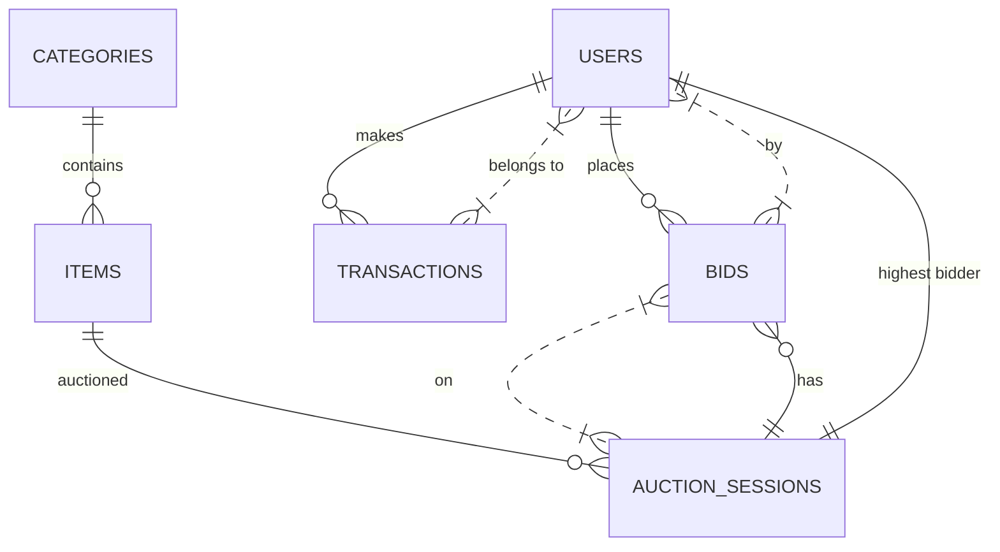

# DATABASE_SCHEMA.md

## Tổng quan
Dự án **Đấu giá Trực tuyến** dùng **Firebase Firestore** làm kho dữ liệu NoSQL. Ở đây chúng ta mô tả schema tương đương cho một CSDL quan hệ (PostgreSQL/MySQL) để nhóm có thể triển khai nếu muốn.

---

### 1. Bảng `users`
| Trường | Kiểu | Ghi chú |
|-------|------|--------|
| `id` | `BIGINT` (PK) | ID người dùng |
| `fullname` | `VARCHAR(255)` | Họ và tên |
| `email` | `VARCHAR(255)` **UNIQUE** | Email |
| `role` | `VARCHAR(50)` | `USER`, `ADMIN` … |
| `avatar` | `VARCHAR(255)` | Đường dẫn ảnh |
| `created_at` | `TIMESTAMPTZ` | Thời gian tạo |

### 2. Bảng `categories`
| Trường | Kiểu | Ghi chú |
|-------|------|--------|
| `category_id` | `BIGINT` (PK) | ID danh mục |
| `category_name` | `VARCHAR(255)` | Tên danh mục |
| `icon_url` | `VARCHAR(255)` | Icon URL |

### 3. Bảng `items`
| Trường | Kiểu | Ghi chú |
|-------|------|--------|
| `id` | `BIGINT` (PK) | ID vật phẩm |
| `item_name` | `VARCHAR(255)` | Tên vật phẩm |
| `starting_price` | `BIGINT` | Giá khởi điểm (VND) |
| `description` | `TEXT` | Mô tả |
| `image_url` | `VARCHAR(255)` | Ảnh |
| `status` | `VARCHAR(20)` | `available`, `in_auction`, `sold` |
| `category_id` | `BIGINT` (FK → `categories.category_id`) | Thuộc danh mục (nullable) |

### 4. Bảng `auction_sessions`
| Trường | Kiểu | Ghi chú |
|-------|------|--------|
| `session_id` | `VARCHAR(36)` (PK) | ID phiên (UUID) |
| `item_id` | `BIGINT` (FK → `items.id`) | Vật phẩm đang đấu giá |
| `starting_price` | `BIGINT` | Giá khởi điểm |
| `current_highest_bid` | `BIGINT` | Giá cao nhất hiện tại |
| `highest_bidder_id` | `BIGINT` (FK → `users.id`) | Người đặt giá cao nhất (nullable) |
| `start_time` | `TIMESTAMPTZ` | Thời gian bắt đầu |
| `end_time` | `TIMESTAMPTZ` | Thời gian kết thúc |
| `status` | `VARCHAR(20)` **CHECK** (`status IN ('upcoming','active','ended','cancelled')`) | Trạng thái phiên |

### 5. Bảng `bids`
| Trường | Kiểu | Ghi chú |
|-------|------|--------|
| `bid_id` | `BIGINT` (PK) | ID lượt đặt giá |
| `bid_amount` | `BIGINT` | Giá đặt (VND) |
| `bid_time` | `TIMESTAMPTZ` | Thời gian đặt |
| `user_id` | `BIGINT` (FK → `users.id`) | Người đặt |
| `session_id` | `VARCHAR(36)` (FK → `auction_sessions.session_id`) | Phiên đấu giá |

### 6. Bảng `transactions`
| Trường | Kiểu | Ghi chú |
|-------|------|--------|
| `transaction_id` | `BIGINT` (PK) | ID giao dịch |
| `amount` | `BIGINT` | Số tiền (VND) |
| `payment_method` | `VARCHAR(50)` | Ví điện tử, thẻ … |
| `status` | `VARCHAR(20)` | `Thành công`, `Thất bại` … |
| `user_id` | `BIGINT` (FK → `users.id`) | Người thực hiện |
| `created_at` | `TIMESTAMPTZ` | Thời gian tạo |

---

## Ràng buộc & Indexes
* **PK** – mỗi bảng có một khóa chính.
* **FK** – quan hệ `users ↔ bids`, `users ↔ transactions`, `categories ↔ items`, `items ↔ auction_sessions`, `auction_sessions ↔ bids`.
* **UNIQUE** – `users.email`.
* **CHECK** – `auction_sessions.status`.
* **Indexes** –
  * `idx_auction_active` trên `auction_sessions(status)` (chỉ các phiên còn mở).
  * `idx_bid_session` trên `bids(session_id)` để truy vấn lịch sử đặt giá nhanh.

---

## ERD (Mermaid)

