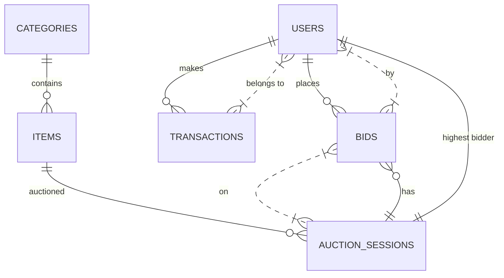

# DATABASE_SCHEMA.md

## Tổng quan
Dự án **Đấu giá Trực tuyến** dùng **Firebase Firestore** làm kho dữ liệu NoSQL. Các bảng bên dưới là bản tham khảo quan hệ, không phải migration để chạy trên Firestore. Quy tắc nghiệp vụ Firestore tại mục tiếp theo là nguồn chuẩn cho backend MVP.

## Quy tắc nghiệp vụ đấu giá (Firestore MVP)

### Trạng thái và thời gian phiên

- Phiên chỉ dùng bốn trạng thái: `scheduled`, `active`, `ended`, `cancelled`. Không dùng xen kẽ `upcoming`.
- Trạng thái theo thời gian máy chủ:
  - `scheduled` khi thời gian hiện tại nhỏ hơn `startTime`.
  - `active` khi `startTime <= thời gian hiện tại < endTime`.
  - `ended` khi thời gian hiện tại lớn hơn hoặc bằng `endTime`.
  - `cancelled` khi phiên được hủy hợp lệ.
- Bid được phép đúng tại `startTime`; bid bị từ chối đúng tại `endTime`.
- `startTime`, `endTime`, `createdAt`, `updatedAt`, `bidTime` lưu bằng Firestore `Timestamp`, không lưu chuỗi ngày giờ. Giờ máy chủ là nguồn quyết định; giao diện hiển thị theo múi giờ Việt Nam.
- Sau khi phiên được công bố, `startTime` và `endTime` không được sửa trong MVP. Không tự động gia hạn phiên.

### Giá và bid

- Giá VND lưu bằng số nguyên (Firestore integer), không dùng số thực/double. `startingPrice` và `minimumIncrement` phải lớn hơn 0.
- Bid đầu tiên phải lớn hơn hoặc bằng `startingPrice`.
- Mỗi bid tiếp theo phải lớn hơn hoặc bằng `currentHighestBid + minimumIncrement`.
- `minimumIncrement` được cấu hình trên từng phiên và không được thay đổi sau khi phiên bắt đầu.
- Người tạo phiên/người bán (`sellerUid`) không được đặt bid trong phiên của mình. Danh tính người đặt lấy từ Firebase Authentication, không tin UID do client tự gửi.
- Nếu phiên kết thúc mà không có bid: trạng thái là `ended`, `result` là `no_bids`, `highestBidderUid` là `null`; `currentHighestBid` giữ giá trị `0`.

### Bid đồng thời và nơi thực thi nghiệp vụ

- Mọi thao tác tạo phiên, hủy phiên, đặt bid và cập nhật kết quả đấu giá phải đi qua Cloud Functions dùng Firebase Admin SDK. Client không được tự ghi bid hoặc sửa các trường trạng thái/giá/người thắng.
- Hàm đặt bid kiểm tra Firebase Authentication UID, trạng thái và khoảng thời gian phiên, quyền seller, rồi kiểm tra giá. Việc tạo bid và cập nhật `currentHighestBid`/`highestBidderUid` phải nằm trong cùng một Firestore transaction.
- Nếu nhiều người bid cùng lúc, Firestore transaction tuần tự hóa các cập nhật xung đột và có thể chạy lại transaction. Mỗi lần chạy lại phải đọc lại dữ liệu phiên và kiểm tra lại toàn bộ điều kiện giá. Bid được chấp nhận khi thỏa ngưỡng mới tại thời điểm transaction ghi thành công; bid không còn đủ cao bị từ chối. Đây là yêu cầu về cạnh tranh runtime, vẫn cần thiết dù chỉ có một người phát triển backend.
- Firestore Security Rules phải yêu cầu xác thực khi đọc dữ liệu riêng tư và từ chối client ghi trực tiếp vào `bids` cũng như các trường nhạy cảm của `auction_sessions` (giá hiện tại, người bid cao nhất, trạng thái và thời gian). Chỉ Cloud Functions đáng tin cậy dùng Admin SDK được quyền ghi các trường này. Không coi việc ẩn nút trên giao diện là kiểm soát bảo mật.

### Hủy phiên

- Người bán chỉ được hủy phiên khi phiên còn `scheduled` và chưa có bid; thao tác phải được kiểm tra ở Cloud Function.
- Không cho người bán hủy phiên đã bắt đầu hoặc đã có bid trong MVP. Không xóa lịch sử bid.
- Không hỗ trợ gia hạn giờ kết thúc trong MVP; bid tại hoặc sau `endTime` luôn bị từ chối.

### Trường dữ liệu Firestore khuyến nghị

- `auction_sessions/{sessionId}`: `itemId`, `sellerUid`, `startingPrice`, `minimumIncrement`, `currentHighestBid`, `highestBidderUid`, `startTime`, `endTime`, `status`, `result`, `createdAt`, `updatedAt`.
- `bids/{bidId}`: `sessionId`, `bidderUid`, `amount`, `bidTime`.
- `users/{uid}`: tài liệu người dùng dùng chính Firebase Authentication UID làm document ID. Email/tên hiển thị chỉ là thông tin hồ sơ, không dùng làm khóa xác thực.

Cloud Functions cần cập nhật trạng thái phiên hết hạn sang `ended` để dữ liệu hiển thị nhất quán. Tuy nhiên, hàm đặt bid vẫn phải tự kiểm tra thời gian với giờ máy chủ; không được chỉ dựa vào việc một tác vụ nền đã kịp đổi `status`.

---

### 1. Bảng `users`
| Trường | Kiểu | Ghi chú |
|-------|------|--------|
| `id` | `BIGINT` (PK) | ID người dùng |
| `fullname` | `VARCHAR(255)` | Họ và tên |
| `email` | `VARCHAR(255)` **UNIQUE** | Email |
| `role` | `VARCHAR(50)` | `USER`, `ADMIN` … |
| `avatar` | `VARCHAR(255)` | Đường dẫn ảnh |
| `created_at` | `TIMESTAMPTZ` | Thời gian tạo |

### 2. Bảng `categories`
| Trường | Kiểu | Ghi chú |
|-------|------|--------|
| `category_id` | `BIGINT` (PK) | ID danh mục |
| `category_name` | `VARCHAR(255)` | Tên danh mục |
| `icon_url` | `VARCHAR(255)` | Icon URL |

### 3. Bảng `items`
| Trường | Kiểu | Ghi chú |
|-------|------|--------|
| `id` | `BIGINT` (PK) | ID vật phẩm |
| `item_name` | `VARCHAR(255)` | Tên vật phẩm |
| `starting_price` | `BIGINT` | Giá khởi điểm (VND) |
| `description` | `TEXT` | Mô tả |
| `image_url` | `VARCHAR(255)` | Ảnh |
| `status` | `VARCHAR(20)` | `available`, `in_auction`, `sold` |
| `category_id` | `BIGINT` (FK → `categories.category_id`) | Thuộc danh mục (nullable) |

### 4. Bảng `auction_sessions`
| Trường | Kiểu | Ghi chú |
|-------|------|--------|
| `session_id` | `VARCHAR(36)` (PK) | ID phiên (UUID) |
| `item_id` | `BIGINT` (FK → `items.id`) | Vật phẩm đang đấu giá |
| `starting_price` | `BIGINT` | Giá khởi điểm |
| `current_highest_bid` | `BIGINT` | Giá cao nhất hiện tại |
| `highest_bidder_id` | `BIGINT` (FK → `users.id`) | Người đặt giá cao nhất (nullable) |
| `start_time` | `TIMESTAMPTZ` | Thời gian bắt đầu |
| `end_time` | `TIMESTAMPTZ` | Thời gian kết thúc |
| `status` | `VARCHAR(20)` **CHECK** (`status IN ('upcoming','active','ended','cancelled')`) | Trạng thái phiên |

### 5. Bảng `bids`
| Trường | Kiểu | Ghi chú |
|-------|------|--------|
| `bid_id` | `BIGINT` (PK) | ID lượt đặt giá |
| `bid_amount` | `BIGINT` | Giá đặt (VND) |
| `bid_time` | `TIMESTAMPTZ` | Thời gian đặt |
| `user_id` | `BIGINT` (FK → `users.id`) | Người đặt |
| `session_id` | `VARCHAR(36)` (FK → `auction_sessions.session_id`) | Phiên đấu giá |

### 6. Bảng `transactions`
| Trường | Kiểu | Ghi chú |
|-------|------|--------|
| `transaction_id` | `BIGINT` (PK) | ID giao dịch |
| `amount` | `BIGINT` | Số tiền (VND) |
| `payment_method` | `VARCHAR(50)` | Ví điện tử, thẻ … |
| `status` | `VARCHAR(20)` | `Thành công`, `Thất bại` … |
| `user_id` | `BIGINT` (FK → `users.id`) | Người thực hiện |
| `created_at` | `TIMESTAMPTZ` | Thời gian tạo |

---

## Ràng buộc & Indexes
* **PK** – mỗi bảng có một khóa chính.
* **FK** – quan hệ `users ↔ bids`, `users ↔ transactions`, `categories ↔ items`, `items ↔ auction_sessions`, `auction_sessions ↔ bids`.
* **UNIQUE** – `users.email`.
* **CHECK** – `auction_sessions.status`.
* **Indexes** –
  * `idx_auction_active` trên `auction_sessions(status)` (chỉ các phiên còn mở).
  * `idx_bid_session` trên `bids(session_id)` để truy vấn lịch sử đặt giá nhanh.

---

## ERD (Mermaid)

